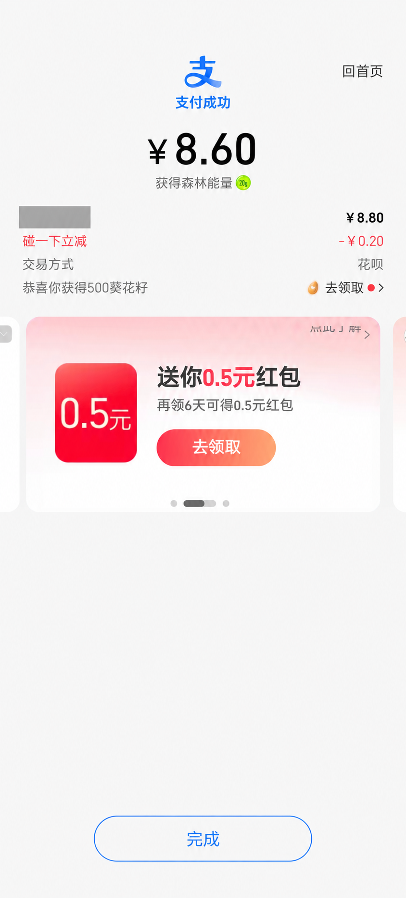
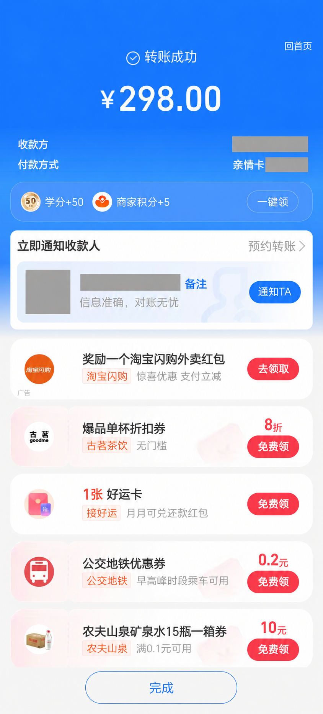
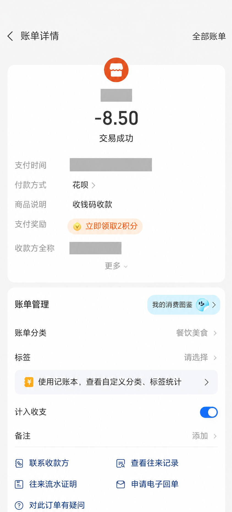

# 记一笔 · Ink Ledger

Android 本地记账应用：手动记账、月度统计与预算，以及微信／支付宝付款识别。当前版本 **0.4.0-alipay-samples**，应用名称「记一笔 · 付款识别」。

付款后在成功页停留，应用会检查所选支付应用的页面；信息不完整或来自 OCR 的结果先放入**待核对**，确认后才计入统计。

## 开始使用

需要 **Android 10（API 29）及以上**；单窗口截图 OCR 需要 **Android 14（API 34）及以上**。本仓库保存源码，不包含 APK；可按下方[构建说明](#从源码构建)生成测试包。

1. 安装测试 APK，打开应用。首次会显示可跳过的四步使用指南。
2. 在底部 **自动** 页选择 **支付宝** 或 **微信**，分别阅读说明并同意。选择微信不会自动授权支付宝，反之亦然。
3. 打开 **付款页面读取**，按系统提示开启「记一笔」的无障碍读取服务；返回后确认状态为 **已连接**。
4. 在所选支付应用中正常付款，停留在**付款成功页**或有成功状态的**单笔账单详情页**片刻，然后回到 **明细** 查看结果。
5. 遇到“需要核对”，先检查商户、金额、类型、时间及是否重复，再点 **确认并入账**。不要为了测试额外付款或转账。

**升级提醒：**当前包名为 `dev.inkledger.app.alipaytest`。使用相同签名的原测试包升级时可直接覆盖安装，不要先卸载；卸载会删除本机账本。换电脑自行构建通常会使用不同的调试签名，不能直接覆盖原包。

### 没识别出来？主动识别一次

先确认 Android 14+、付款页面读取 **已连接**，并在 **自动 → 截图 OCR** 单独同意开启。

1. 先打开微信或支付宝的付款成功页／单笔付款详情页，再切回记一笔。
2. 点 **自动 → 识别当前付款页**，选择对应应用，点 **开始 8 秒倒计时**。
3. 通过最近任务切回对应付款页面：手势导航从底部上滑并停住；三键导航点最近任务键。
4. 等待一次识别，再回到明细核对。**OCR 结果全部先待核对**，不会直接计入统计。

这不是摇一摇、双击背部或相册导入。倒计时可取消；锁屏、切错应用、服务断开、权限关闭或页面禁止截图时会停止。不要在聊天、密码或银行卡页面发起识别。

### 通知读取是可选补充

在 **自动 → 通知读取** 单独授权。只有所选应用实际发出系统付款通知时，这条路径才会触发；没有通知不代表支付失败。微信聊天类通知会过滤，微信付款通知候选也必须核对。

## 支付宝：付款、转账、账单分别处理

以下是根据用户提供的真实页面制作的**脱敏展示副本**。点击图片可看大图；灰块遮盖姓名、商户、头像、关联人、状态栏和交易时间，关键金额保留。

| 付款成功 | 转账成功 | 账单详情 |
| :---: | :---: | :---: |
|  |  |  |

| 页面 | 识别结果 | 不应发生的情况 |
| --- | --- | --- |
| **付款成功** | 示例取主金额 **8.60 元**；缺少完整支付时间时先待核对 | 把原价 8.80、优惠 0.20、广告红包 0.5、积分当成实付 |
| **转账成功** | 识别为转账并跳过自动记账，诊断为 `TRANSFER_NOT_EXPENSE`；如需记录，在明细手动记账并选择“转账” | 新增消费或自动生成待核对转账 |
| **账单详情** | **-8.50** 记为 8.50 元支出，采用账单内的支付时间；历史账单先核对 | 把“商品说明：收钱码收款”当收入，或把状态栏时钟当交易时间 |

主金额不明确时不会拿优惠或广告数字补位，也不会创建零元账目。明确收入、退款和未完成付款不自动记为消费。重复打开同一凭据不会重复累计；不同凭据缺少可靠共同交易号时，仍可能需要你判断是否同一笔，避免重复确认。

## 使用指南随时可以重看

- **自动 → 使用指南**
- **设置 → 使用指南**
- 指南内的 **支付宝三类页面 · 真实图解** 可切换付款／转账／账单，点图片或 **查看大图** 后上下滚动。

首次引导可以跳过、返回和重播手势示意；升级用户不会被强制重新观看。阅读示例不会开启权限、执行识别或生成账目。

## 日常记账与隐私

- **明细**：新增、编辑、删除账目，确认待核对记录；支持支出、收入、退款、转账。
- **统计**：查看月度收支与分类、设置月预算；未确认记录和转账不计入收支。
- **设置**：主题、隐藏金额、减少动态，以及使用指南。
- 微信的聊天、红包、转账、收款和退款不自动记为消费。
- 账本保存在本机 Room 数据库；当前没有云同步，也不访问微信／支付宝账户流水接口。
- 截图只在内存中作本地 OCR，不上传、不写入相册。当前 APK 未申请网络、存储或悬浮窗权限；页面读取、通知读取和 OCR 分别由用户同意。
- 关闭某个来源会停止采集该应用，已有账目保留。荣耀系统胶囊尚未接入，反馈显示在应用内。

### 常见问题

**开了权限还是没记录？** 检查所选应用、服务是否“已连接”，以及是否停留在真正的付款成功／单笔详情页面。完全没有可读文字的页面需要主动单次 OCR；自动 OCR 只在已读到成功凭证但缺金额时尝试。

**为什么要核对？** 缺商户或支付时间、金额存在歧义、历史账单、疑似重复、OCR 或微信通知等情况不能可靠直接确认。待核对不等于已经计入支出。

**怎样反馈问题？** 打开 **自动 → 查看诊断记录**；可主动导出诊断文件。反馈应用与系统版本、页面类型、触发方式、错误结果和诊断代码即可，不要提交密码、验证码、完整交易号或未脱敏截图。

详细手机操作：[支付宝实图自测](docs/ALIPAY-REAL-SAMPLES.md) · [微信使用说明](docs/WECHAT-QUICKSTART.md)

## 从源码构建

准备 JDK 17、Android SDK Platform 35 和 Build Tools 35.0.0。用 Android Studio 打开 `android/`，设置 Gradle JDK 为 17 和本机 SDK 路径；也可通过 `JAVA_HOME`、`ANDROID_HOME` 配置命令行环境。首次构建需要下载 Gradle 和 Maven 依赖。

Windows PowerShell，在仓库根目录运行：

```powershell
cd android
.\gradlew.bat :app:assembleDebug
```

macOS／Linux 使用 `./gradlew :app:assembleDebug`。默认 APK 输出为 `android/app/build/outputs/apk/debug/app-debug.apk`。

Windows 中文路径若出现 Gradle worker 参数文件编码问题，可将**构建输出**改到自选的纯英文绝对路径，源码不必移动：

```powershell
.\gradlew.bat -PinkBuildRoot=C:/ink-ledger-build :app:assembleDebug
```

此时 APK 位于 `C:/ink-ledger-build/app/outputs/apk/debug/app-debug.apk`。安装 `app` 模块的包即可；`capture-fixture` 是历史合成采集测试辅助模块，**不要安装到个人手机**。

### 不启动设备的检查

```powershell
.\gradlew.bat :app:testDebugUnitTest :ledger-core:testDebugUnitTest :app:lintDebug
```

0.4 本地交付时 **73 项 JVM 测试通过**，lint **0 errors / 25 warnings**，APK 构建与设备测试源码编译通过。三张页面的规则测试使用脱敏人工转录，不是实际图片 OCR 成功率；本轮没有运行模拟器或真机测试，真实页面、授权与显示效果由用户实测。发布前将测试日期改为虚构值后，相关 **15 项转录测试再次通过**。

## 工程导航

- [`android/app`](android/app)：原生 View 界面、权限、通知／页面采集、本地 OCR 与引导。
- [`android/ledger-core`](android/ledger-core)：Room 账本、金额与统计、解析与去重、测试。
- [`backend`](backend)：可选后端接口草案，当前无运行服务。
- [`design`](design)：视觉与交互设计记录，历史阶段以文档日期为准。
- [`docs`](docs)：手机操作与脱敏素材说明。

原始支付截图、参考图库、账本数据库、签名文件、本机配置、日志、缓存和 APK 不纳入源码提交。仅三张已脱敏的引导资源随应用保存，见[素材说明](docs/GUIDE-ASSETS.md)。

## 来源与许可

选择性复用 AutoAccounting 的账单类型、部分模型／统计设计、矢量图标和 Gradle Wrapper，保留原版权及 [GPL v3 许可文本](android/LICENSE)。本项目新写微信／支付宝解析与采集链路，没有复制上游远程私有规则或 Hook 能力。

复用范围、上游文件头声明冲突和 Google ML Kit 独立依赖说明见[第三方通知](android/THIRD-PARTY-NOTICES.md)与[复用记录](android/ledger-core/UPSTREAM.md)。微信、支付宝及相关商标用于适配说明，不代表官方合作。
